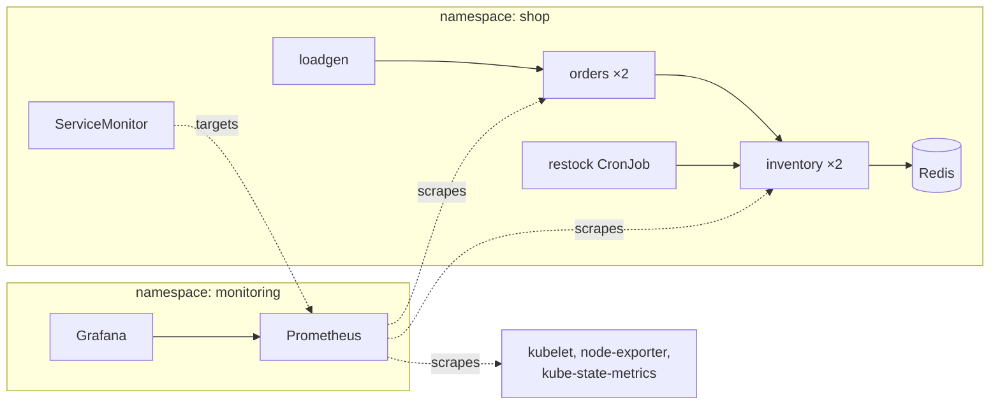
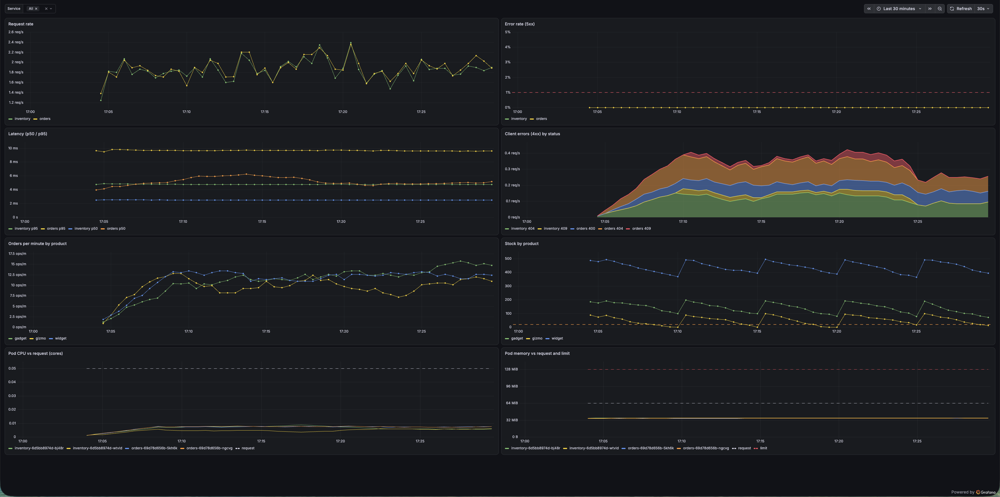
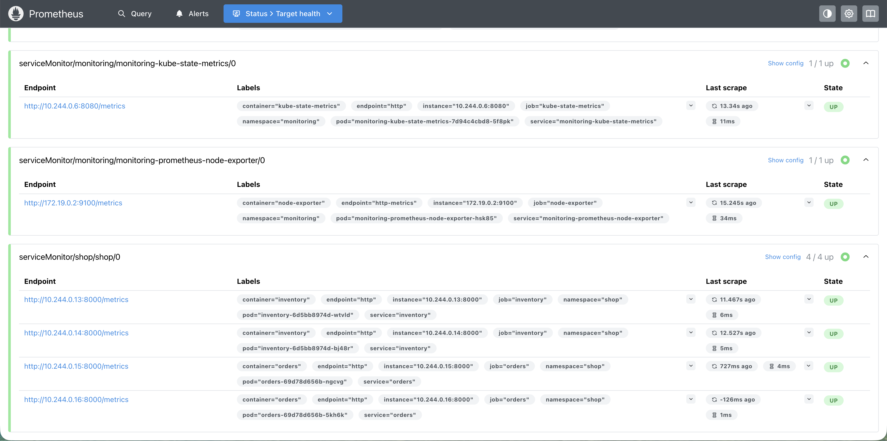

# Kubernetes observability stack

A small online shop running on Kubernetes, with Prometheus and Grafana monitoring around it.

**Stack:** Kubernetes (kind) · Helm · Prometheus · Grafana · Python (FastAPI) · Redis · Docker

It runs on a local kind cluster: four apps (an orders API, an inventory service, Redis and a load generator) across six pods, plus a CronJob that restocks inventory every five minutes. The monitoring stack is installed with Helm.

The services expose RED metrics (rate, errors, duration) and business metrics, the load generator keeps realistic traffic flowing, and a Grafana dashboard shows service health, stock levels and each pod's resource use against its requests and limits. The whole stack comes up from a fresh clone with `make up`.


## Architecture



- **Traffic** flows from the load generator to orders, which calls inventory, which keeps the stock in Redis. Every call uses a Service name, resolved by cluster DNS.
- **Metrics are pulled.** Prometheus scrapes each pod's `/metrics` endpoint every 15 seconds. The ServiceMonitor tells it which pods to scrape, through the Prometheus Operator. Pod CPU and memory come from the kubelet's built-in cAdvisor, and object state (such as ready replicas) from kube-state-metrics.
- **Grafana** queries Prometheus. The dashboard is a JSON file in this repo, loaded into Grafana from a ConfigMap.

## What's in it

All three apps are small Python (FastAPI) services.

| Component | What it does | Kubernetes objects |
|---|---|---|
| **orders** | The shop's API: lists products and places orders by calling inventory | Deployment (2 replicas), Service, ConfigMap |
| **inventory** | Owns the stock, kept in Redis, and reserves it in one atomic step so two orders can't take the last item | Deployment (2 replicas), Service, ConfigMap |
| **Redis** | The shared stock store, password-protected | Deployment, Service, Secret |
| **restock** | Resets the stock every 5 minutes, like a delivery arriving | CronJob |
| **loadgen** | Sends about 2 requests a second, including some deliberately invalid ones | Deployment, ConfigMap |
| **kube-prometheus-stack** | Prometheus, Alertmanager, Grafana, node-exporter, kube-state-metrics and the Prometheus Operator | Helm release |
| **shop ServiceMonitor** | Tells Prometheus which pods to scrape: those behind the orders and inventory Services | ServiceMonitor (custom resource) |
| **Shop dashboard** | RED metrics, business metrics, and pod CPU and memory | ConfigMap, loaded by Grafana's sidecar |


## Design decisions

**Health checks**
- **Readiness checks dependencies, liveness doesn't.** Inventory's readiness probe pings Redis, so when Redis is down its pods are taken out of the Service without being restarted, since a restart wouldn't fix Redis. Liveness only checks that the process answers, so a dependency blip can't restart every pod.
- **Orders' readiness doesn't check inventory**, to avoid a cascading failure where an inventory outage takes orders out of service too.

**Data and secrets**
- **Redis is a Deployment with no persistent storage**, to keep the focus on the monitoring. Inventory reseeds the starting stock whenever Redis comes back empty. A production database would be a StatefulSet with persistent storage.
- **The Redis password is generated at setup and never committed.** `make up` creates the Secret with a random value, only if it doesn't already exist.

**Monitoring**
- **RED metrics are labelled with the route template, never the raw URL**, and requests that match no route are labelled `unmatched`, so cardinality stays bounded.
- **Requests and limits are right-sized from the dashboard.** The load generator used about a quarter of its memory request, so the request was cut from 64Mi to 32Mi.
- **The dashboard is code.** Its JSON lives in this repo and is loaded through a ConfigMap labelled for Grafana's sidecar, so it survives Grafana restarts and appears on a fresh cluster.

## Screenshots

The full dashboard, adding business metrics (orders per minute and stock by product) and pod CPU and memory against requests and limits. Click to enlarge:



Prometheus scraping both orders pods and both inventory pods through the ServiceMonitor:



## Running it

You need Docker (Docker Desktop, Colima or similar, with about 4 CPUs and 8 GB of memory), [kind](https://kind.sigs.k8s.io/), kubectl and Helm. On macOS: `brew install kind kubectl helm`.

```bash
make up          # create the cluster and deploy everything (about 5 minutes)
make grafana     # in a second terminal, then open http://localhost:3000/d/shop-overview
make prometheus  # optional, then open http://localhost:9090
make down        # delete the cluster
```

Log in to Grafana as `admin`. The password is generated by the chart:

```bash
kubectl get secret monitoring-grafana -n monitoring -o jsonpath='{.data.admin-password}' | base64 -d; echo
```

### Try breaking it

Take Redis away, watch the dashboard for a few minutes, then bring it back:

```bash
kubectl scale deployment redis -n shop --replicas=0
kubectl scale deployment redis -n shop --replicas=1
```

## Repo layout

```
services/     App code and Dockerfiles: orders, inventory, loadgen
k8s/          Kubernetes manifests, one folder per app, plus the namespace and ServiceMonitor
helm/         Values for the kube-prometheus-stack chart
dashboards/   Grafana dashboard JSON
scripts/      up.sh and down.sh, run by make
```

## What's next

- **Traces with OpenTelemetry.** An OpenTelemetry Collector as a DaemonSet (an agent on each node) feeding a gateway Deployment, the OpenTelemetry Operator injecting auto-instrumentation into the Python services, Tempo for traces linked from Grafana, and tail sampling at the gateway.
- **Logs, SLOs and alerting.** Loki for logs, with trace IDs so Grafana can jump between logs, metrics and traces. An SLO per service with multi-window burn-rate alerts routed through Alertmanager.
- **Redis as a StatefulSet** with persistent storage.
- **Cloud and GitOps.** Terraform to run the same stack on EKS, ArgoCD for deployment from this repo, and GitHub Actions to build images and validate manifests.
